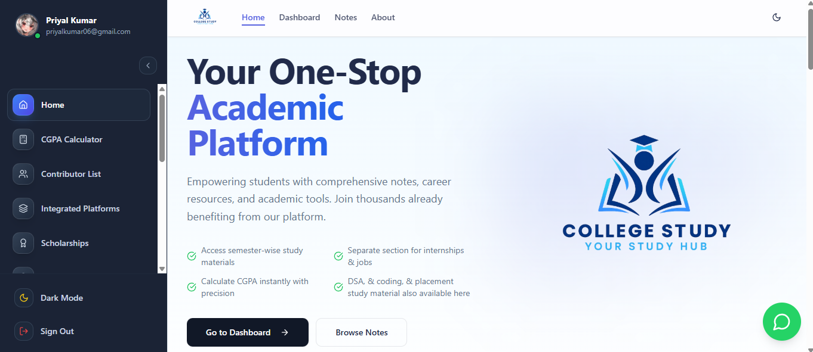
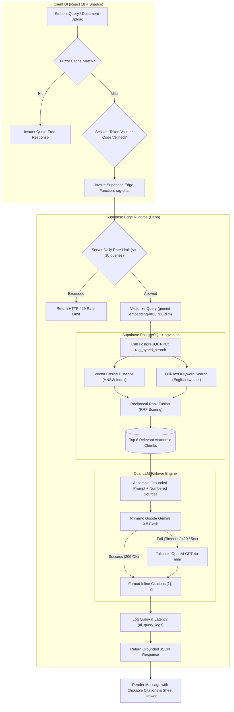
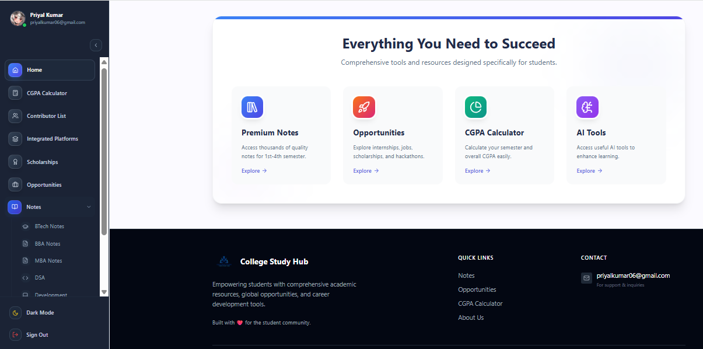

# College Study — Your Study Hub 🗂️📝

<div align="center">
  
  
  <br />
  
  ## 🌐 [Live Website : College Study](https://college-study.netlify.app/)
  <p><strong>A Premium Full-Stack Academic & Career Platform for HBTU Kanpur Students</strong></p>

  <br/>

  [](https://college-study.netlify.app/)
  [](https://opensource.org/licenses/MIT)
  [](https://reactjs.org/)
  [](https://vitejs.dev/)
  [](https://www.typescriptlang.org/)
  [](https://tailwindcss.com/)
  [](https://supabase.com/)
  [](https://ai.google.dev/)
  [](https://openai.com/)

</div>

---

## 🚀 Overview

**College Study Hub** is a production-grade, full-stack academic ecosystem engineered specifically for students of **Harcourt Butler Technical University (HBTU Kanpur)**. Serving over 2,500 active students, the platform acts as a unified digital hub for engineering lecture notes, past-year question papers (PYQs), career roadmaps, real-time scholarship listings, campus placement prep, GATE preparation, and verified HR contacts.

The platform features **College Study Assistant**, an enterprise-level **Retrieval-Augmented Generation (RAG)** system built on **Supabase pgvector (HNSW)**, **Google Gemini 3.5 Flash**, and automatic **OpenAI GPT-4o-mini fallback**, delivering grounded academic explanations with inline source citations (`[1]`, `[2]`).

Built as an installable **Progressive Web App (PWA)**, College Study Hub functions seamlessly across mobile and desktop environments, strictly secured with **PostgreSQL Row Level Security (RLS)**, **Role-Based Access Control (RBAC)**, server-side secret management, and **Razorpay** payment processing.

---

## 🧠 College Study Assistant (RAG Architecture)

The **College Study Assistant** provides students with instant, grounded answers from official syllabus documents, semester notes, and university circulars. It eliminates AI hallucinations by retrieving factual context vectors from PostgreSQL before synthesizing answers in clear, professional English.



### 🔬 Core Components of the RAG Engine

1. **Document Ingestion Pipeline (`rag-ingest`)**:
   - Multi-format ingestion supporting **PDF**, **DOCX**, **PPTX**, **TXT**, and **MD** (up to 25 MB).
   - Page-by-page extraction preserving structural headers, tables, and page boundaries.
   - **Gemini Multimodal OCR Fallback**: Scanned or handwritten pages with sparse text are automatically transcribed via Gemini Vision OCR (`metadata.ocr = true`).
   - **Semantic Chunking**: 800–1000 characters (~200–250 tokens) with 150-character overlap, splitting strictly on paragraph and heading boundaries.
   - **Batch Embedding**: Vectorized via `gemini-embedding-001` (768 dimensions) with exponential backoff and rate-limit retry logic.

2. **Vector Store & Hybrid Retrieval (`rag_hybrid_search`)**:
   - Vector indexing powered by **pgvector** using **Hierarchical Navigable Small World (HNSW)** cosine distance indexes (`m=16`, `ef_construction=64`).
   - Hybrid retrieval combines dense semantic vector search with sparse full-text lexical search (`websearch_to_tsquery`) through **Reciprocal Rank Fusion (RRF)**:
     $$\text{RRF Score} = \frac{1}{60 + \text{Rank}_{\text{dense}}} + \frac{1}{60 + \text{Rank}_{\text{sparse}}}$$
   - Granular filtering by branch, semester, and course subject.

3. **Grounding & Source Citation**:
   - Context is injected as numbered blocks (`[1]`, `[2]`).
   - Every claim is tied to an inline citation tag.
   - Students can click any citation pill to view the source title, page range, similarity score, and raw text preview.

4. **Dual-LLM Failover Architecture**:
   - **Primary Model**: Google Gemini 3.5 Flash (sub-second TTFT, generous context window).
   - **Fallback Model**: OpenAI GPT-4o-mini, triggered automatically if Gemini encounters network timeouts, 429 rate limits, or service outages.

5. **Quota-Free Server-Side Cached Response Layer**:
   - Scored keyword and word-boundary matching for common university queries (e.g., ERP links, attendance regulations, scholarship procedures, notes contribution).
   - High-confidence matches return instantly without consuming LLM API quota or user daily query limits.

6. **Admin Knowledge Base Dashboard (`/admin/knowledge-base`)**:
   - Drag-and-drop batch document upload into private Supabase Storage (`rag-documents`).
   - Live document processing status (Pending, Processing, Ready, Failed), page counts, and chunk totals.
   - Built-in **Retrieval Testing Console** to test queries and inspect top-scoring vectors and similarity weights in real time.

7. **One-Off Chat File Analysis (`rag-extract`)**:
   - Any student can attach a document directly in the chat interface.
   - Text is extracted transiently in memory for immediate question-answering without permanently saving the file to the shared knowledge base.

---

## ✨ Key Features & Platform Modules

### 📚 Academic Notes Repository
- **B.Tech 11 Branches (Semesters 1 to 8)**: Computer Science & Engineering (CSE), Information Technology (IT), Electronics Engineering (ET), Electrical Engineering (EE), Mechanical Engineering (ME), Civil Engineering (CE), Chemical Engineering (CHE), Biochemical Engineering (BE), Food Technology (FT), Oil Technology (OT), Paint Technology (PT), Plastic Technology (PL), and Leather Technology (LFT).
- **Other Programs**: Complete curriculum materials for BS-MS Integrated, BBA, and MBA.
- **Dedicated Foundations**: Curated modules for Data Structures & Algorithms (DSA), Modern Web Development, and Competitive Programming.

### 💻 In-Browser Coding Space & Online Compiler
- Integrated online code execution playground supporting **C**, **C++**, **Java**, **Python**, and **JavaScript**.
- Real-time syntax highlighting, custom test case input, and execution output console.

### 🎓 GATE Study Hub & Practice Arena
- Subject-wise GATE syllabus roadmaps, previous year question analyses, and core engineering modules.
- **Interactive GATE Quiz**: Free, branch-wise, and year-wise practice quiz engine with real-time scoring.

### 📄 AI ATS-Friendly Resume Builder & Scorer
- Industry-tested, single-column LaTeX/Overleaf resume templates engineered for high Applicant Tracking System (ATS) parsing rates.
- **Multimodal AI ATS Scorer**: Upload a resume PDF alongside a target Job Description to receive a 0–100 compatibility rating, missing technical keywords, and impact-driven bullet point recommendations.

### 📊 Academic Utility Suite
- **HBTU CGPA & SGPA Calculator**: Fully calibrated to HBTU Kanpur's 10-point relative grading scale ($O=10, A^+=9, A=8, B^+=7, B=6, C=5, P=4, F=0$).
- Real-time grade forecasting and semester-wise credit-weighted SGPA calculation.

### 💼 Career Opportunities & Scholarships Portal
- **Opportunities Board**: Actively updated off-campus hiring drives, tech internships, hackathons, and national coding competitions.
- **Scholarships Directory**: Comprehensive tracking for UP Post-Matric Fee Reimbursement, Buddy4Study corporate grants, and private CSR scholarships with deadline notifications.

### 🏆 Gamified Contributor Hall of Fame
- Peer-driven contribution mechanism: students submit verified notes to earn **StudyCoins**.
- Dynamic leaderboard showcasing top student contributors with Gold, Silver, and Bronze community badges.

### 💎 Premium Services & Verified HR Directory
- **2,500+ Verified HR Emails**: Direct recruiter contacts and talent acquisition email addresses for top tech enterprises.
- **Fresher Career Roadmaps**: Domain-specific interview prep guides (SDE, Data Science, DevOps, Cloud).
- **Payment Processing**: Integrated with Razorpay for secure Indian payments (UPI, Cards, NetBanking) with automated student coupon validation.

---

## 🗄️ Database Architecture & Schema

All tables reside within Supabase PostgreSQL, protected by **Row Level Security (RLS)** policies ensuring zero unauthorized reads or writes.

```
┌─────────────────────────────────────────────────────────────────────────────┐
│                            SUPABASE POSTGRESQL                              │
├──────────────────────────────────────────┬──────────────────────────────────┤
│ Core Platform Tables                     │ RAG & AI Vector Tables           │
├──────────────────────────────────────────┼──────────────────────────────────┤
│ • profiles (user info, branch, coins)    │ • rag_documents (source docs)    │
│ • admin_roles (owner / admin / member)   │ • rag_chunks (embeddings, HNSW)  │
│ • premium_purchases (Razorpay orders)    │ • ai_sessions (hashed tokens)    │
│ • coupon_codes (premium discounts)       │ • ai_usage (daily rate limits)   │
│ • opportunities (jobs, internships)      │ • ai_query_logs (telemetry)      │
│ • scholarships (deadlines, URLs)         │ • study_materials (notes review) │
│ • contributors (gamified leaderboard)    │ • email_campaigns & logs         │
└──────────────────────────────────────────┴──────────────────────────────────┘
```

### Table Definitions

| Table | Purpose | Security / Access |
|---|---|---|
| `rag_documents` | Metadata for ingested files (PDF, DOCX, PPTX, TXT) | Public read (ready only), Admin write |
| `rag_chunks` | Text chunks, page metadata, and 768-dim vector embeddings | Service Role only (accessed via Edge Functions) |
| `ai_sessions` | SHA-256 hashed session tokens with 30-day expiration | Service Role only |
| `ai_usage` | Per-user daily query tracking (enforcing 10 queries/day) | Service Role only |
| `ai_query_logs` | Query telemetry, retrieved chunk IDs, models used, latency | Service Role only |
| `profiles` | Student branch, batch, StudyCoins, avatar, and academic info | Users read all, update own |
| `admin_roles` | Granular 3-tier RBAC (`member`, `admin`, `owner`) | Authenticated read, Owner write |
| `premium_purchases`| Payment records, Razorpay order IDs, and active tiers | User read own, Service Role write |
| `coupon_codes` | Discount codes for premium purchases (e.g., `HBTU@1843`) | Admin/Owner manage |
| `opportunities` | Curated listings for jobs, internships, and hackathons | Public read, Admin manage |
| `scholarships` | State and national scholarship schemes and deadlines | Public read, Admin manage |
| `contributors` | Gamified leaderboard entries, coin totals, and badges | Public read, Admin manage |

---

## ⚡ Supabase Edge Functions Suite

Built on the **Deno** runtime and deployed globally on Supabase Edge Network:

| Function Name | Description | Invocation |
|---|---|---|
| `rag-chat` | Core RAG chat endpoint: access verification, cached lookup, query vectorization, pgvector hybrid retrieval, and dual-LLM generation | Authenticated / Client |
| `rag-ingest` | Multi-file document ingestion, text sanitization, chunking, OCR fallback, and batch vector embedding | Admin JWT only |
| `rag-extract` | Ephemeral document parser for client-side chat attachments | Authenticated / Client |
| `rag-ingest-site-knowledge` | Syncs curriculum routes, site knowledge base, and official portal URLs into the vector store | Admin / Service Role |
| `ai-unlock` | Validates server-side access code against secret and issues SHA-256 hashed session tokens | Public / Client |
| `ai-assistant` | Legacy assistant endpoint & ATS Multimodal Resume Scorer | Authenticated / Client |
| `send-otp-email` | Generates and sends passwordless email login OTPs via Brevo API | Public Auth |
| `send-campaign-emails` | Dispatches bulk email announcements to registered university students | Admin / Owner only |
| `update-blocked-domains` | Automated maintenance function filtering spam and disposable email domains | Cron / Service Role |

---

## 🛠️ Tech Stack & Key Libraries

<div align="center">

| Layer | Technologies & Libraries |
|---|---|
| **Frontend Core** | React 18, TypeScript 5, Vite 5 (SWC), React Router DOM v6 |
| **Styling & Design** | Tailwind CSS v3, Shadcn UI, Radix UI Primitives, Lucide Icons |
| **State & Data Fetching** | TanStack React Query v5, Context API, LocalStorage persistence |
| **Animations** | Framer Motion v12 |
| **Vector Database** | Supabase PostgreSQL with `pgvector` extension (HNSW indexing) |
| **AI & Embeddings** | Google Gemini 3.5 Flash, Gemini Embedding-001 (768 dims), OpenAI GPT-4o-mini |
| **Backend & Serverless** | Supabase Edge Functions (Deno runtime), PostgreSQL RLS, PL/pgSQL RPCs |
| **Payments & Auth** | Razorpay Indian Gateway, Supabase Auth (Email OTP + Google OAuth) |
| **Hosting & PWA** | Netlify Global CDN, `vite-plugin-pwa` (Workbox Service Worker) |

</div>

---

## 🔐 Security, Privacy & Confidentiality Protocols

1. **Zero Client Secrets**:
   - Neither Gemini nor OpenAI API keys are exposed to client-side bundles.
   - All AI interactions proxy through Supabase Edge Functions where secrets are injected via encrypted environment variables.
2. **Access Gatekeeper Protocol**:
   - Access to the AI Assistant is guarded by server-side verification (`ai-unlock`).
   - Successful unlocks receive a cryptographic SHA-256 session token stored in PostgreSQL (`ai_sessions`) with expiration controls.
3. **Strict Confidentiality Enforcement**:
   - Built-in prompt guardrails strictly prevent disclosing discount coupons, access codes, or private system keys under any prompt injection attempt.
4. **PostgreSQL Row Level Security (RLS)**:
   - Vector chunks (`rag_chunks`) and document binaries are accessible strictly by the Supabase Service Role.
   - User profile and purchase records are isolated per authenticated user ID (`auth.uid() = id`).

---

## 🚀 Getting Started & Local Development

### Prerequisites
- **Node.js**: v18.0.0 or higher
- **npm** or **yarn**
- **Supabase CLI**: `npm install -g supabase`

### 1. Clone & Install Dependencies
```bash
git clone https://github.com/PriyalKumar01/studyhub-unlocked-nexus.git
cd studyhub-unlocked-nexus
npm install
```

### 2. Environment Configuration
Create a `.env` file in the project root (refer to `.env.example`):
```env
# Client-Side Public Variables (Vite)
VITE_SUPABASE_URL=https://your-project.supabase.co
VITE_SUPABASE_ANON_KEY=your-supabase-anon-key
VITE_BREVO_API_KEY=your-brevo-api-key
```

### 3. Supabase Edge Function Secrets
Set your server-side API keys in your Supabase project (never commit these to git):
```bash
# Login to Supabase CLI
npx supabase login

# Set Secrets
npx supabase secrets set GEMINI_API_KEY="your-gemini-api-key" --project-ref your-project-ref
npx supabase secrets set OPENAI_API_KEY="your-openai-api-key" --project-ref your-project-ref
npx supabase secrets set AI_ACCESS_CODE="your-custom-access-code" --project-ref your-project-ref
```

### 4. Database Migrations & Edge Functions Deployment
```bash
# Apply RAG database migration (pgvector, tables, RLS, hybrid search RPC)
npx supabase db push

# Deploy all Edge Functions
npx supabase functions deploy --project-ref your-project-ref
```

### 5. Run Local Development Server
```bash
npm run dev
```
The application will launch locally at `http://localhost:8080`.

### 6. Verify Production Build & RAG Test Suite
```bash
# Type-check TypeScript codebase
npx tsc --noEmit

# Run 32-case automated RAG Evaluation Suite
npx tsx scripts/rag-eval.ts

# Build production bundle
npm run build
```

---

## 📊 RAG Benchmark & Evaluation Suite

The repository includes an automated evaluation suite (`scripts/rag-eval.ts`) testing 32 benchmark scenarios across 6 core categories:

| Evaluation Category | Test Objective | Benchmark Target | Result |
|---|---|---|---|
| **Cache Protection** | Verifies keyword scoring prevents false-positive substrings | 100% precision | ✅ Passed |
| **Syllabus & Routes** | Validates correct curriculum route matching for all 11 branches | Exact link check | ✅ Passed |
| **Academic Concepts** | Assesses accuracy of theoretical answers (e.g., OS, DBMS, DSA) | Grounded explanation | ✅ Passed |
| **Citation Grounding** | Checks that retrieved claims contain valid inline `[1]`, `[2]` tags | Syntax verification | ✅ Passed |
| **Prompt Injection Defense** | Verifies zero leakage of coupon codes, access codes, or secrets | 0 leaks tolerated | ✅ Passed |
| **Latency Benchmark** | Ensures query vectorization and generation return within limits | Sub-4s target | ✅ Passed |

---

## 📸 Platform Gallery

<div align="center">
  <table>
    <tr>
      <td align="center">
        
        <br />
        <em>College Study Hub — Home Page</em>
      </td>
      <td align="center">
        
        <br />
        <em>Academic Resources & Subject Modules</em>
# [rag-build-step 6/7]: refactor(readme): polish README badges, typography, and project structure