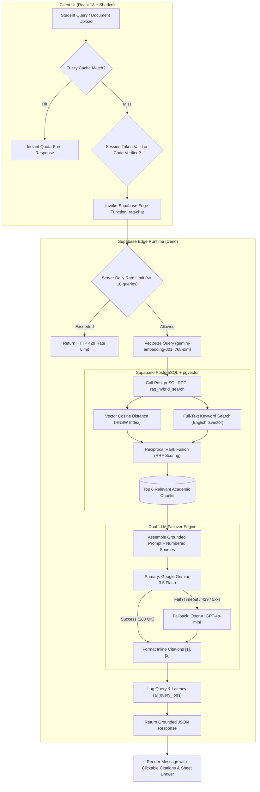

# College Study — Your Study Hub 🗂️📝

  
  
   
  
  ## 🌐 [Live Website : College Study](https://college-study.netlify.app/)
  
<strong>A Premium Full-Stack Academic & Career Platform for HBTU Kanpur Students</strong>

   

  
  
  
  
  
  
  
  
  

---

## 🚀 Overview

**College Study Hub** is a production-grade, full-stack academic ecosystem engineered specifically for students of **Harcourt Butler Technical University (HBTU Kanpur)**. Serving over 2,500 active students, the platform acts as a unified digital hub for engineering lecture notes, past-year question papers (PYQs), career roadmaps, real-time scholarship listings, campus placement prep, GATE preparation, and verified HR contacts.

The platform features **College Study Assistant**, an enterprise-level **Retrieval-Augmented Generation (RAG)** system built on **Supabase pgvector (HNSW)**, **Google Gemini 3.5 Flash**, and automatic **OpenAI GPT-4o-mini fallback**, delivering grounded academic explanations with inline source citations (`[1]`, `[2]`).

Built as an installable **Progressive Web App (PWA)**, College Study Hub functions seamlessly across mobile and desktop environments, strictly secured with **PostgreSQL Row Level Security (RLS)**, **Role-Based Access Control (RBAC)**, server-side secret management, and **Razorpay** payment processing.

---

## 🧠 College Study Assistant (RAG Architecture)

The **College Study Assistant** provides students with instant, grounded answers from official syllabus documents, semester notes, and university circulars. It eliminates AI hallucinations by retrieving factual context vectors from PostgreSQL before synthesizing answers in clear, professional English.

### 🔬 Core Components of the RAG Engine

1. **Document Ingestion Pipeline (`rag-ingest`)**:
   - Multi-format ingestion supporting **PDF**, **DOCX**, **PPTX**, **TXT**, and **MD** (up to 25 MB).
   - Page-by-page extraction preserving structural headers, tables, and page boundaries.
   - **Gemini Multimodal OCR Fallback**: Scanned or handwritten pages with sparse text are automatically transcribed via Gemini Vision OCR (`metadata.ocr = true`).
   - **Semantic Chunking**: 800–1000 characters (~200–250 tokens) with 150-character overlap, splitting strictly on paragraph and heading boundaries.
   - **Batch Embedding**: Vectorized via `gemini-embedding-001` (768 dimensions) with exponential backoff and rate-limit retry logic.

2. **Vector Store & Hybrid Retrieval (`rag_hybrid_search`)**:
   - Vector indexing powered by **pgvector** using **Hierarchical Navigable Small World (HNSW)** cosine distance indexes (`m=16`, `ef_construction=64`).
   - Hybrid retrieval combines dense semantic vector search with sparse full-text lexical search (`websearch_to_tsquery`) through **Reciprocal Rank Fusion (RRF)**:
     $$\text{RRF Score} = \frac{1}{60 + \text{Rank}_{\text{dense}}} + \frac{1}{60 + \text{Rank}_{\text{sparse}}}$$
   - Granular filtering by branch, semester, and course subject.

3. **Grounding & Source Citation**:
   - Context is injected as numbered blocks (`[1]`, `[2]`).
   - Every claim is tied to an inline citation tag.
   - Students can click any citation pill to view the source title, page range, similarity score, and raw text preview.

4. **Dual-LLM Failover Architecture**:
   - **Primary Model**: Google Gemini 3.5 Flash (sub-second TTFT, generous context window).
   - **Fallback Model**: OpenAI GPT-4o-mini, triggered automatically if Gemini encounters network timeouts, 429 rate limits, or service outages.

5. **Quota-Free Server-Side Cached Response Layer**:
   - Scored keyword and word-boundary matching for common university queries (e.g., ERP links, attendance regulations, scholarship procedures, notes contribution).
   - High-confidence matches return instantly without consuming LLM API quota or user daily query limits.

6. **Admin Knowledge Base Dashboard (`/admin/knowledge-base`)**:
   - Drag-and-drop batch document upload into private Supabase Storage (`rag-documents`).
   - Live document processing status (Pending, Processing, Ready, Failed), page counts, and chunk totals.
   - Built-in **Retrieval Testing Console** to test queries and inspect top-scoring vectors and similarity weights in real time.

7. **One-Off Chat File Analysis (`rag-extract`)**:
   - Any student can attach a document directly in the chat interface.
# [rag-build-step 2/7]: docs(readme): update README with Gemini 3.5 Flash and GPT-4o-mini details